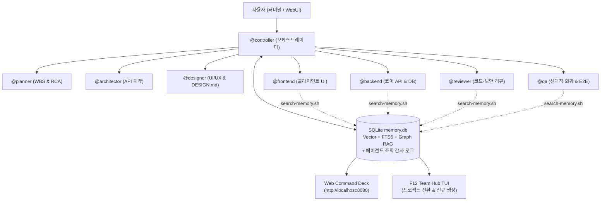

# Herdr Multi-Agent Dev Squad

> [🇺🇸 English](README.md) | [🇰🇷 한국어](README.ko.md)

[`herdr`](https://github.com/herdr-ai/herdr) 기반의 **8인 전문 AI 에이전트 멀티 프로젝트 개발 워크스페이스**입니다.  
**SQLite 벡터 + FTS5 + 지식 그래프 RAG 메모리(`memory.db`)**, **`F12` 대화형 Team Hub TUI**, **실시간 Web Command Deck**을 하나의 워크플로우로 통합했습니다.


---

## 아키텍처



---

## 핵심 기능

- **8인 전문 에이전트 스쿼드 (4탭 × 2패인)**: `herdr`에 `Dev1..Dev4` 레이아웃을 자동 구성하고 역할 경계를 엄격히 분리합니다 (`Controller`는 제품 소스 수정 금지, `Reviewer`/`QA`는 읽기 전용).
- **CLI 및 모델 자유 교체 (`.team/agents.json`)**: [agents.example.json](.team/agents.example.json)을 복사해 역할별로 `agy`, `pi`, `claude`, `opencode`, `codex` 및 원하는 모델을 자유롭게 지정할 수 있습니다.
- **멀티 프로젝트 격리 & `F12` Team Hub**:
  - `dev switch <프로젝트>` 또는 `F12` 팝업으로 프로젝트 간 전환 시 8개 에이전트 세션을 자동 스냅샷 저장 및 복원합니다.
  - Team Hub에서 `n` 키를 눌러 새 디렉토리 경로를 입력하면 신규 프로젝트 생성 + 이전 세션 보존 + 8개 에이전트 초기화 기동까지 한 번에 처리됩니다.
- **SQLite 하이브리드 Vector + FTS5 + Knowledge Graph RAG (`memory.db`)**:
  - `fastembed` 코사인 유사도 + FTS5 키워드 랭킹(RRF) + `WITH RECURSIVE` 다중 홉 인과 체인 + 코드 심볼 그래프를 결합합니다.
  - `.team/scripts/search-memory.sh --agent <역할>` 호출 이력이 `memory_access_logs`에 자동 기록되어 대시보드에서 실시간 감사할 수 있습니다.
- **실시간 Web Command Deck (`dev web`)**:
  - 에이전트 토폴로지 패킷 시각화, 활성 프로젝트별 2D 지식 그래프, 벡터 RAG 스트림, 조회 감사 배지, 태스크 산출물 마크다운 뷰어, `@controller` 채팅(로컬 캡처 이미지 렌더링 + 라이트박스 확대) 제공.
- **기동 전 CLI 자동 업데이트**: `dev up` / `dev start` 실행 시 에이전트 CLI 업데이트를 자동 확인합니다 (`--no-update` 또는 `DEV_SKIP_UPDATE=1`로 생략 가능).
- **토큰 최적화 프로토콜**: 작업 복잡도별 3단계 라우팅(Level 1/2/3), 3~4줄 참조 기반 `herdr` 프롬프트(Zero-Dump), 변경 범위 기반 선택적 QA 적용.

---

## 8인 에이전트 구성

| 탭 | 역할 | 담당 영역 | 기본 CLI / 모델 *(커스터마이즈 가능)* |
|---|---|---|---|
| **Dev1** | `@controller` | 오케스트레이션, 태스크 배분, `status.json`, `sync-memory.sh` | `agy` (Gemini 3.8 Flash) |
| **Dev1** | `@planner` | 요구사항 분석, WBS, 결함 근본원인(RCA), 수정 계획 | `agy` (Gemini 4 Neon) |
| **Dev2** | `@architector` | Contract-First API/타입 계약, DB 스키마, 리팩토링 설계 | `pi` (Muse Spark 1.3) |
| **Dev2** | `@designer` | UI/UX 설계, `PRODUCT.md`/`DESIGN.md`, `impeccable` 크래프트 | `agy` (Gemini 4 Argon) |
| **Dev3** | `@frontend` | 클라이언트 UI, 상태 관리, API 연동, 타깃 단위 테스트 | `agy` (Gemini 4 Hydrogen) |
| **Dev3** | `@backend` | API 엔드포인트, 도메인 로직, DB 처리, 타깃 단위 테스트 | `agy` (Gemini 4 Hydrogen) |
| **Dev4** | `@reviewer` | 독립 코드·계약·보안 리뷰 (읽기 전용) | `pi` (Muse Spark 1.3) |
| **Dev4** | `@qa` | 변경 범위 기반 회귀 및 타깃 Playwright E2E 검증 (읽기 전용) | `pi` (Muse Spark 1.3) |

---

## 사전 준비물

외부 CLI 바이너리는 본 저장소에 포함되지 않으므로 별도 설치가 필요합니다.
- [`herdr`](https://github.com/herdr-ai/herdr)
- `python3` (3.10+) 및 [`uv`](https://docs.astral.sh/uv/) (`indexer.py` / `search.py`의 `fastembed` 실행용)
- 지원 에이전트 CLI 1종 이상 (`agy`, `pi`, `claude`, `opencode`, `codex`)

---

## 빠른 시작 (Quick Start)

```bash
# 1. 저장소 클론 및 초기 설치
git clone https://github.com/moongul/herdr-dev-squad.git ~/Work/Dev
cd ~/Work/Dev
./install.sh

# 2. (선택) 역할별 CLI 및 모델 커스터마이즈
nano .team/agents.json

# 3. 대상 프로젝트 연결 (신규 경로면 템플릿 자동 생성)
dev switch ~/Work/my-project

# 4. 8인 에이전트 스쿼드 기동 및 Herdr TUI 접속
dev up && dev start

# 5. Web Command Deck 실행 (http://localhost:8080)
dev web
```

---

## 주요 CLI 명령어

```bash
dev up [--no-update]     # CLI 업데이트 체크 후 4x2 레이아웃 및 8인 에이전트 기동/복원
dev start                # Herdr 'Dev' 세션 접속 (미기동 시 'dev up' 자동 실행)
dev stop                 # 8개 세션 스냅샷 저장 후 안전 종료
dev status               # 활성 프로젝트 및 8인 에이전트 상태 확인
dev update               # 에이전트 CLI 수동 업데이트 (agy, pi, herdr)
dev switch <이름|경로>   # 프로젝트 전환 또는 신규 생성 (세션 스냅샷/복원 포함)
dev hub                  # 대화형 Team Hub TUI 열기 (F12 단축키 연동)
dev web [port]           # Web Command Deck 실행 (기본 포트: 8080)
dev web stop | log       # WebUI 중지 또는 로그 실시간 조회
```

---

## 라이선스

MIT License — 자세한 내용은 [LICENSE](LICENSE)를 참고하세요.
