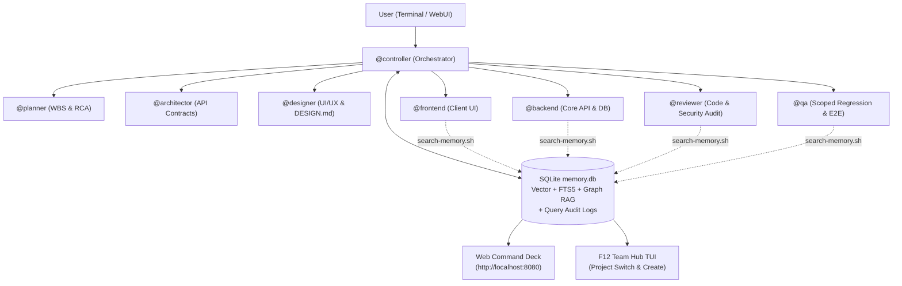

# Herdr Multi-Agent Dev Squad

> [🇺🇸 English](README.md) | [🇰🇷 한국어](README.ko.md)

A **multi-agent software engineering workspace** built on top of [`herdr`](https://github.com/herdr-ai/herdr), combining **8 specialized AI agent roles**, a **SQLite Vector + FTS5 + Knowledge Graph RAG memory**, an **interactive `F12` Team Hub TUI**, and a **real-time Web Command Deck**.

### Web Command Deck (`dev web`)


### Herdr 4×2 Multi-Pane & `F12` Team Hub Popup (`dev start`)


---

## Architecture



---

## Key Features

- **8-Agent Specialized Squad (4 Tabs × 2 Panes)**: Automatically provisions `Dev1..Dev4` in `herdr` with strict role boundaries (`Controller` never edits product code; `Reviewer`/`QA` are strictly read-only).
- **CLI & Model Agnostic (`.team/agents.json`)**: Mix and match `agy`, `pi`, `claude`, `opencode`, or `codex` per role via `.team/agents.json` (template in [agents.example.json](.team/agents.example.json)).
- **Multi-Project Isolation & `F12` Team Hub**:
  - Switch between projects with automatic 8-agent session snapshot & resume (`dev switch <project>` or `F12` TUI).
  - Press `n` in Team Hub to bind or create a new project directory—previous sessions are snapshotted safely and all 8 agents launch fresh for the new project.
- **SQLite Hybrid Vector + FTS5 + Knowledge Graph RAG (`memory.db`)**:
  - Combines `fastembed` cosine similarity, FTS5 keyword ranking (RRF), multi-hop `WITH RECURSIVE` task causal chains, and code entity/symbol graphs.
  - Every agent lookup via `.team/scripts/search-memory.sh --agent <role>` is logged to `memory_access_logs` and displayed live on the dashboard.
- **Real-Time Web Command Deck (`dev web`)**:
  - Live Agent Topology & animated working cards, Force-Directed 2D Knowledge Graph (scoped per active project), Vector Memory RAG Stream, Agent Query Audit, Task Artifact Markdown preview, and `@controller` chat with local screenshot rendering & lightbox zoom.
- **Pre-Start CLI Auto-Update**: `dev up` / `dev start` automatically checks for agent CLI updates (`--no-update` or `DEV_SKIP_UPDATE=1` to skip).
- **Token-Optimized Workflow**: Complexity-based routing (Level 1 / 2 / 3), Pass-by-Reference 3–4 line `herdr` prompts (Zero-Dump), and Scope-Based Selective QA.

---

## 8-Agent Role Matrix

| Tab | Role | Responsibility | Default CLI / Model *(Customizable)* |
|---|---|---|---|
| **Dev1** | `@controller` | Orchestration, task dispatch, `status.json`, `sync-memory.sh` | `agy` (Gemini 3.8 Flash) |
| **Dev1** | `@planner` | Requirements, WBS, Root Cause Analysis (RCA), Fix Plans | `agy` (Gemini 4 Neon) |
| **Dev2** | `@architector` | Contract-First API/type specs, DB schemas, refactoring plans | `pi` (Muse Spark 1.3) |
| **Dev2** | `@designer` | UI/UX flows, `PRODUCT.md`/`DESIGN.md`, `impeccable` craft | `agy` (Gemini 4 Argon) |
| **Dev3** | `@frontend` | Client UI, state, API wiring, targeted component tests | `agy` (Gemini 4 Hydrogen) |
| **Dev3** | `@backend` | Endpoints, domain logic, DB persistence, targeted unit tests | `agy` (Gemini 4 Hydrogen) |
| **Dev4** | `@reviewer` | Independent code, contract, and security audit (read-only) | `pi` (Muse Spark 1.3) |
| **Dev4** | `@qa` | Scope-based regression & targeted Playwright E2E (read-only) | `pi` (Muse Spark 1.3) |

---

## Prerequisites

External CLI tools are **not bundled** in this repository—install them separately:
- [`herdr`](https://github.com/herdr-ai/herdr) (terminal multiplexer & agent orchestrator)
- `python3` (3.10+) and [`uv`](https://docs.astral.sh/uv/) (used by `indexer.py` & `search.py` for isolated `fastembed` execution)
- One or more supported agent CLIs (`agy`, `pi`, `claude`, `opencode`, `codex`)

---

## Quick Start

```bash
# 1. Clone and bootstrap
git clone https://github.com/moongul/herdr-dev-squad.git ~/Work/Dev
cd ~/Work/Dev
./install.sh

# 2. (Optional) Customize CLIs & models per role
#    - Default mixed preset: .team/agents.example.json (copied automatically by install.sh)
#    - Claude Code-only preset:
cp .team/agents.claude-only.json .team/agents.json
nano .team/agents.json

# 3. Bind your target project directory (creates template if new)
dev switch ~/Work/my-project

# 4. Launch the 8-agent squad & attach to Herdr TUI
dev up && dev start

# 5. Launch the Web Command Deck (http://localhost:8080)
dev web
```

---

## CLI Reference

```bash
dev up [--no-update]     # Check CLI updates, build 4x2 layout & start/resume 8 agents
dev start                # Attach to Herdr 'Dev' session (runs 'dev up' if stopped)
dev stop                 # Snapshot all 8 sessions & stop Herdr session safely
dev status               # Show active project & 8 agent statuses
dev update               # Manually check and update agent CLIs (agy, pi, herdr)
dev switch <name|path>   # Switch to (or create) a project with session snapshot/resume
dev hub                  # Open interactive Team Hub TUI (also bound to F12)
dev web [port]           # Start Web Command Deck (default: 8080)
dev web stop | log       # Stop WebUI or tail server logs
```

---

## Repository Layout

```text
.
├── dev                         # Main CLI entrypoint
├── install.sh                  # Bootstrap script
├── AGENTS.md                   # Shared multi-agent constitution
├── .agents/roles/              # Per-role guidelines (controller..qa)
└── .team/
    ├── TEAM.md                 # Team workflow, state machine & protocols
    ├── agents.example.json     # Mixed CLI/model mapping template (agy + pi)
    ├── agents.claude-only.json # Claude Code-only preset for all 8 roles
    ├── memory/                 # SQLite Vector + FTS5 + Graph RAG (schema, indexer, search)
    ├── projects/template/      # Template for new project spaces
    ├── scripts/                # session_manager.py, switch-project.sh, team_hub.py, memory wrappers
    ├── templates/              # Standard markdown report templates
    └── web/                    # Real-time Web Command Deck (server.py, index.html)
```

---

## License

MIT License — see [LICENSE](LICENSE).
